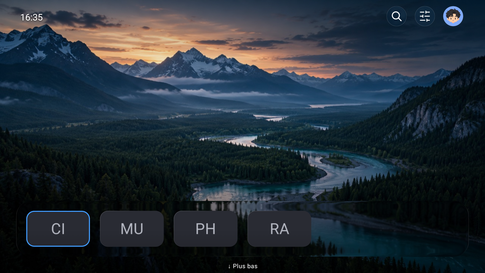
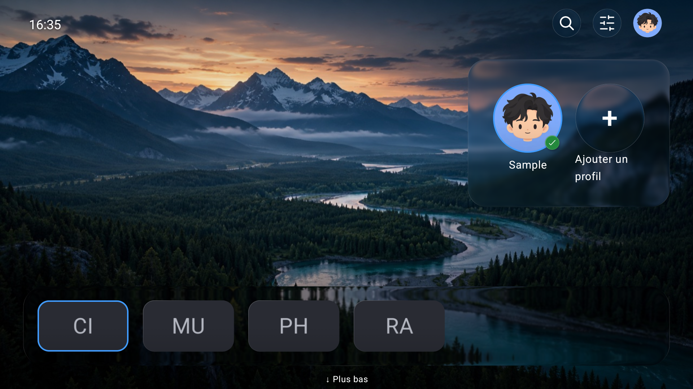
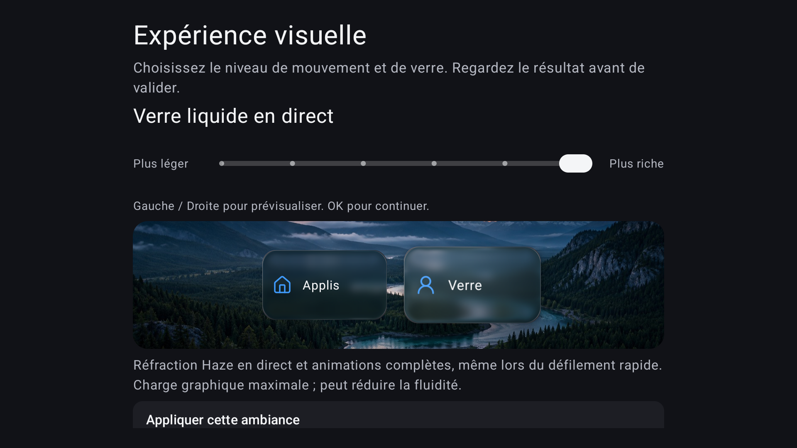

# Oree

A launcher for Android TV and Google TV. Browse your apps, keep favorites in a dock, and organize the rest into folders—all with your remote.

Oree includes local profiles, search, wallpapers and English/French menus. Optional features add Continue Watching, local photos, a screensaver and settings backup. Your streaming apps still handle playback and their own accounts.

**Development preview:** there is no downloadable release yet. To try it, follow the [build and install guide](docs/GETTING_STARTED.md). Keep your current launcher installed.

## Choose your look

Open **Settings → Appearance → Visual experience**. Use Left/Right to preview a level, then choose Apply. The choice is saved for the current profile.

| Level | What you get | Expected graphics workload |
| --- | --- | --- |
| 1. Simple | Solid surfaces, static focus, no glass or background blur | Lowest |
| 2. Light | Gentle animations, solid surfaces | Low |
| 3. Balanced | Softer animations, light glass and background blur | Moderate |
| 4. Rich | Full card motion and stronger glass | High |
| 5. Full effect | Strongest glass and blur, with prepared effects reused where possible | Higher |
| 6. Live Liquid Glass | Highest-quality live glass; full card animation even while holding an arrow key | Highest |

Try **Balanced** first. Move left if scrolling feels choppy; move right if you prefer richer effects. These are relative workload descriptions, not measured FPS ratings. See the [visual quality guide](docs/PERFORMANCE.md) for the differences and accessibility options.

| Floating profiles | Visual experience |
| --- | --- |
|  |  |

[About these sample screenshots](docs/screenshots/README.md).

## Privacy and everyday use

No required account, ads or telemetry. Core app launching works offline. Optional content artwork can download over HTTPS when content sources are enabled. Continue Watching depends on what installed apps share with Android TV; some apps may supply nothing.

Profiles keep separate launcher layouts and appearances. They do not switch accounts inside streaming apps. Backups save settings and image references; they do not include the image files themselves.

## Learn more

- [Build and install](docs/GETTING_STARTED.md)
- [Visual quality and performance](docs/PERFORMANCE.md)
- [Folders](docs/FOLDER_MANAGEMENT.md), [content and photos](docs/CONTENT_CAPABILITIES.md), [compatibility](docs/ANDROID_COMPATIBILITY.md)
- [All documentation](docs/README.md)
- [Contributing](CONTRIBUTING.md) and [public source preparation](docs/PUBLICATION.md)

Original work is licensed under [Apache-2.0](LICENSE). See [third-party notices](THIRD_PARTY.md).
